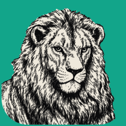

<p align="center">
  
</p>

<h1 align="center">AlePdf</h1>

<p align="center">
  <b>Professional PDF Editor for macOS</b><br>
  An advanced, open-source PDF reader and editor built in pure Rust.<br>
  Comparable to Adobe Acrobat Pro: Fast, native, private, and unrestricted.
</p>

<p align="center">
  
  
  
  
  
</p>

<p align="center">
  <a href="#key-features">Key Features</a> ·
  <a href="#workspaces">Workspaces</a> ·
  <a href="#installation">Installation</a> ·
  <a href="#building-from-source">Building from Source</a> ·
  <a href="#architecture">Architecture</a> ·
  <a href="#license">License</a>
</p>

---

## Overview

**AlePdf** is a desktop PDF editing application built for macOS (supporting both Apple Silicon `arm64` and Intel `x86_64`). Engineered with pure Rust, AlePdf delivers native desktop performance, instant file opening, continuous scrolling, and true PDF content editing without subscriptions, cloud dependencies, or artificial usage limits.

### Core Principles

- **Unlimited Local Usage:** Zero cloud processing, zero telemetry, and zero subscriptions. Every document is created, edited, and saved directly on your local machine.
- **Genuine Content Editing:** Directly modify text, images, vectors, form fields, and annotations rather than painting simple visual overlays.
- **File Integrity & Safety:** Safe atomic saves, incremental updates preserving original file structures, deep undo/redo stacks, and automatic recovery against crashes.
- **Acrobat Pro Parity:** Full suite of professional PDF tools including text editing, page organization, interactive forms, digital certificates, redaction, and OCR.

---

## Key Features

### 1. Document & Text Editing
- **Direct Text Modification:** Insert, edit, replace, copy, and reposition text blocks inside PDF streams.
- **Typography & Font Fidelity:** Full support for system and embedded fonts, kerning, ligatures, alignment, multi-line reflow, and world scripts (including vertical CJK, Arabic, and Hebrew).
- **Search & Replace:** Fast whole-document search with regex, case sensitivity, and reading-order extraction.


### 2. Images, Graphics & Objects
- **Image Manipulation:** Insert, replace, extract, crop, resize, and rotate embedded raster images.
- **Vector Shapes & Drawing:** Add rectangles, ellipses, lines, arrows, polygons, and custom ink paths.
- **Headers, Footers & Watermarks:** Apply customizable watermarks, running headers, and bates numbering.

### 3. Page Management & Organization
- **Visual Thumbnail Grid:** View all pages simultaneously with zoomable thumbnail cards.
- **Operations:** Drag-and-drop page reordering, rotation, deletion, duplication, blank page insertion, and page replacement.
- **Combine & Split:** Merge multiple PDF files into one with retained bookmark hierarchies, or split documents by page ranges or intervals.

### 4. Interactive Forms & Signatures
- **AcroForm Support:** Create, inspect, and fill interactive text fields, checkboxes, radio groups, dropdown combos, and list boxes.
- **Digital Signatures:** Cryptographic signing with PKCS#12 certificates, timestamp authorities, and signature verification.
- **Handwritten Signatures & Stamps:** Quick signature pad and pre-designed approval stamps.

### 5. Security & Redaction
- **Standard PDF Encryption:** Support for 40-bit RC4, 128-bit/256-bit AES (revisions 2 through 6).
- **Owner & User Passwords:** Restrict printing, copying, and modifications with customizable permission flags.
- **True Redaction:** Permanently removes text and raster graphics from the underlying PDF content streams before export.

### 6. OCR (Optical Character Recognition)
- Built-in machine learning OCR pipeline converting scanned papers and raster images into searchable, selectable PDF documents.

---

## Workspaces

AlePdf organizes your document workflow into dedicated, distraction-free workspaces:

| Workspace | Purpose |
|---|---|
| **Edit PDF** | In-place text formatting, block repositioning, and image replacement |
| **Organize Pages** | Visual grid for rotating, reordering, extracting, splitting, and inserting pages |
| **Comment** | Threaded comments, highlights, underlines, callouts, and drawing markups |
| **Fill & Sign** | Interactive form filling, typed/drawn signatures, and date stamps |
| **Prepare Forms** | Visual drag-and-drop form field builder with property inspectors |
| **Protect** | AES encryption, password assignment, and permanent redaction |
| **Scan & OCR** | Convert scanned documents and photos into searchable text |
| **Compare Files** | Side-by-side visual and textual diffing between document versions |

---

## Installation

### macOS (.dmg Installer)

1. Download the latest release disk image: **`AlePdf.dmg`**.
2. Double-click **`AlePdf.dmg`** to mount the installer.
3. Drag **`AlePdf.app`** into your **`Applications`** folder.
4. Launch **AlePdf** from Finder, Spotlight, or the Dock.

> **Note on Gatekeeper:** If running an ad-hoc local build, right-click `AlePdf.app` in `/Applications` and select **Open** on first launch, or approve it in *System Settings → Privacy & Security*.

---

## Building from Source

Building AlePdf requires Rust 1.95+ and macOS command-line tools.

### 1. Prerequisites

```bash
# Ensure Rust stable is installed
curl --proto '=https' --tlsv1.2 -sSf https://sh.rustup.rs | sh
rustup default stable
rustup target add aarch64-apple-darwin x86_64-apple-darwin
```

### 2. Clone and Run

```bash
git clone https://github.com/themanoftalent/alepdf.git
cd alepdf

# Run native desktop app in debug mode
cargo run -p pdfcraft

# Build optimized release binary
cargo run --release -p pdfcraft
```

### 3. Package macOS Universal App & DMG

The packaging script compiles both Apple Silicon (`arm64`) and Intel (`x86_64`) binaries, combines them via `lipo` into a universal Mach-O executable, creates `AlePdf.app`, and packages `AlePdf.dmg`:

```bash
chmod +x packaging/macos/package.sh packaging/env.sh
./packaging/macos/package.sh --arch universal
```

The resulting artifacts are placed in:
- `dist/release/AlePdf.dmg` (macOS drag-to-install disk image)
- `target/macos-package/AlePdf.app` (macOS application bundle)
- `dist/release/alepdf-cli-*-macos-universal.zip` (command-line suite)

---

## Architecture

AlePdf is built as a modular Cargo workspace ensuring strict separation of concerns between core PDF parsing, rendering, document security, and the graphical interface:

```
AlePdf
├── apps/
│   ├── pdfcraft/           # AlePdf desktop application entry point & macOS lifecycle
│   └── pdfcraft-cli/       # Headless CLI & automation runner
├── crates/
│   ├── cos/                # PDF object stream tokenizer, parser & repair engine
│   ├── crypt/              # AES-128/256 and RC4 security handler & SASLprep
│   ├── render/             # Hardware-accelerated page rendering & text extraction
│   ├── edit/               # Content stream editor & typography transformer
│   ├── annot/              # Annotation appearance streams & comment management
│   ├── forms/              # Interactive AcroForm & XFA runtime
│   ├── sign/               # Cryptographic PKCS#7 / PAdES signing
│   ├── redact/             # Content sanitization & permanent stream redaction
│   ├── ocr/                # OCR text detection & recognition engine
│   ├── engine/             # Unified document session & undo/redo façade
│   └── ui-egui/            # Retained-mode GPU-accelerated macOS interface
└── packaging/
    └── macos/              # Info.plist, entitlements, app icon, and DMG generator
```

---

## License

AlePdf is intended to be dual-licensed under:

- **MIT License** ([LICENSE-MIT](LICENSE-MIT))
- **Apache License, Version 2.0** ([LICENSE-APACHE](LICENSE-APACHE))

Bundled third-party fonts, icons, and assets should be documented in [ATTRIBUTION.md](ATTRIBUTION.md).

> **Implementation status:** This README describes the intended AlePdf product and architecture. Features, build commands, repository availability, licensing files, and release artifacts have not been independently verified against the source repository. All package names, source paths, icon files, bundle identifiers, and packaging scripts must be migrated consistently before the renamed build can be expected to work.
