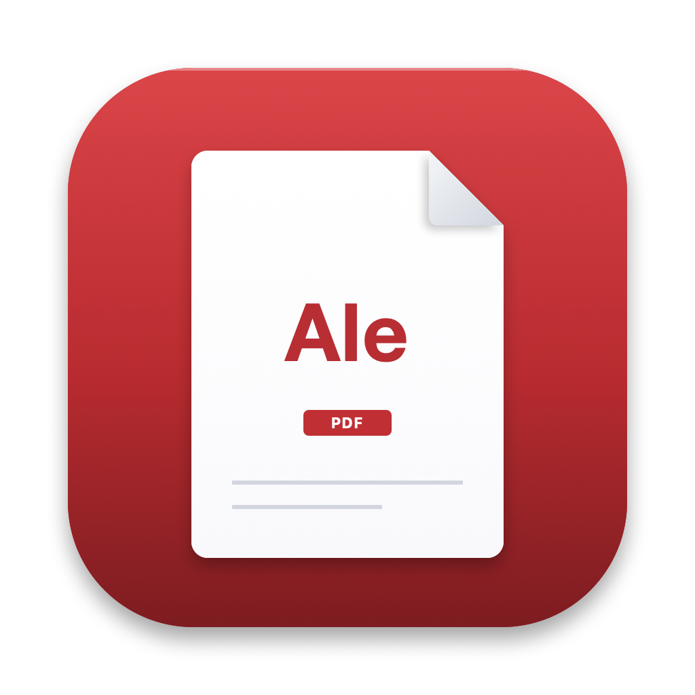
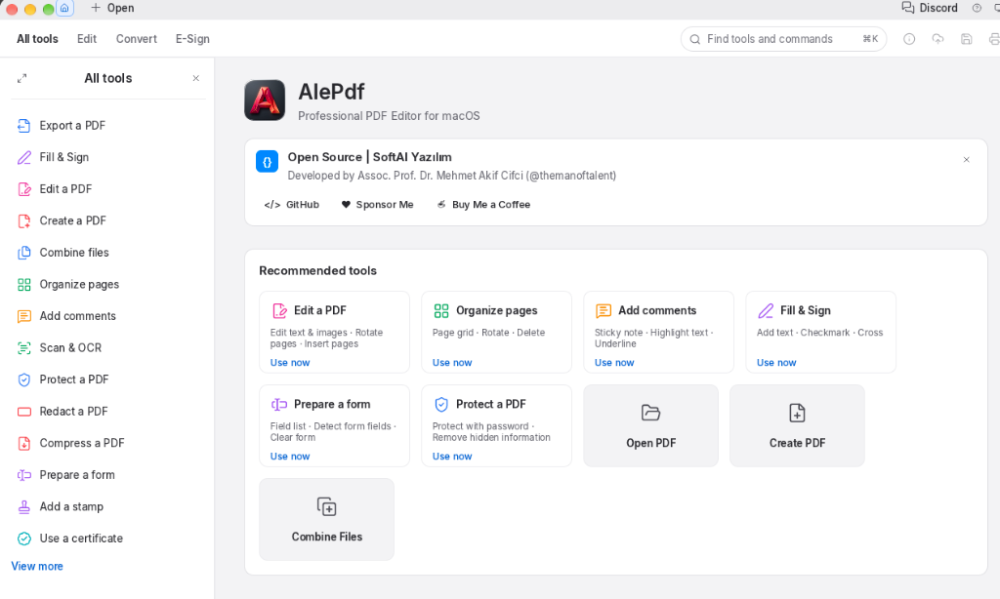

<p align="center">
  
</p>

<h1 align="center">PdfAle</h1>

<p align="center">
  <b>The modern, fast, private PDF editor and workbench built in pure Rust.</b><br>
  Read, edit, annotate, organize, combine, split, and protect PDFs in a blazing-fast native app.<br>
  <b>macOS · Windows · Linux · FreeBSD · Web</b>
</p>

<p align="center">
  <a href="https://macosuygulama.vercel.app/"></a>
  <a href="https://github.com/themanoftalent/pdfale/releases"></a>
  
  
  
</p>

<p align="center">
  <a href="https://macosuygulama.vercel.app/"><b>Official Website</b></a> ·
  <a href="https://github.com/themanoftalent/pdfale/releases"><b>Download Releases</b></a> ·
  <a href="https://github.com/themanoftalent/pdfale/issues"><b>Report Issue</b></a>
</p>

<br>

<p align="center">
  
  <br>
  <sub>PdfAle Welcome &amp; Tools Hub: modern native workbench with tools for in-place editing, page organizing, forms, and security.</sub>
</p>

---

<p align="center">
  <a href="#highlights">Highlights</a> ·
  <a href="#features">Features</a> ·
  <a href="#downloads">Downloads</a> ·
  <a href="#built-for-agents--cli">Agents &amp; CLI</a> ·
  <a href="#architecture">Architecture</a> ·
  <a href="#building-from-source">Building from Source</a> ·
  <a href="#license">License</a>
</p>

---

## Highlights

<table>
<tr>
<td width="33%" valign="top">

### ⚡ Blazing Fast &amp; Native
Engineered from the ground up in 100% pure Rust. Instant startup, silky-smooth scrolling, multi-threaded rendering, and minimal memory footprint.

</td>
<td width="33%" valign="top">

### 🛡️ Non-Destructive &amp; Safe
Atomic saves and incremental PDF updates ensure your original file bytes remain intact. Deep multi-level undo/redo and automatic crash recovery protect your work.

</td>
<td width="33%" valign="top">

### 🔒 100% Private &amp; Local
No mandatory accounts, no analytics, no telemetry, and no cloud processing. All document operations, OCR, and editing run entirely offline on your local device.

</td>
</tr>
</table>

---

## Features

### ✏️ In-Place PDF Text &amp; Image Editing
- Click directly on text blocks to edit wording, font attributes, sizing, alignment, and formatting.
- Integrated text reflow handles line wrapping, margins, and paragraph reorganizations naturally.
- Replace, move, resize, and rotate embedded images with live visual feedback.

### 📑 Visual Page Organization
- **Page Grid Overview**: See your entire document laid out like cards on a table.
- **Rearrange &amp; Duplicate**: Drag and drop to reorder pages, duplicate sections with Option/Ctrl-drag.
- **Rotate &amp; Delete**: Rotate portrait/landscape or delete unwanted pages in bulk.
- **Insert**: Inject blank pages or merge pages directly from external PDF documents.

### 💬 Rich Annotations &amp; Comments
- Markup text with highlights, underlines, strikethroughs, and squiggles.
- Insert sticky notes, callout boxes, shapes (rectangles, ellipses, arrows, polygons), and freehand ink drawings.
- Track review conversations in the dedicated threaded comments sidebar.

### 📝 Interactive Form Filling &amp; Creation
- Fill AcroForm and XFA fields seamlessly: text fields, multi-line boxes, checkboxes, radio buttons, dropdown lists, and combo boxes.
- Sign documents with digital signatures or handwritten ink signatures.
- Reset and clear forms or export form data with single-click actions.

### 🔀 Combine &amp; Split PDFs
- **Merge**: Combine multiple PDF files into a single master document, automatically organizing bookmarks into clean hierarchical trees.
- **Split**: Divide large documents into individual pages, chapters, or custom page number intervals.
- **Extract**: Isolate specific page selections into standalone PDF files without losing interactive form fields, layers, or attachments.

### 🔐 Security, Encryption &amp; Permissions
- Comprehensive PDF standard security handler: RC4 40/128-bit and AES-128 / AES-256 encryption.
- Respect and manage document permissions (printing, editing, copying, annotations).
- Permanent redaction and sanitization to scrub hidden metadata, scripts, and private data before distribution.

---

## Downloads

Download pre-built releases directly from our [Official Website](https://macosuygulama.vercel.app/) or [GitHub Releases](https://github.com/themanoftalent/pdfale/releases):

### macOS
- **Apple Silicon (M1/M2/M3/M4)**: [`PdfAle-0.18.2-macos-aarch64.dmg`](https://github.com/themanoftalent/pdfale/releases/tag/v0.18.2)
- Fast native execution, system file association, drag-and-drop installer.

### Windows
- **64-bit Windows (x64)**: Available via GitHub Releases (`.exe` / `.msi` / portable `.zip`).
- Full Explorer right-click context menu integration ("Edit with PdfAle").

### Linux &amp; Other Platforms
- Available as standalone binary, AppImage, and tarball builds across x86_64 and aarch64 architectures.

---

## Built for Agents &amp; CLI

PdfAle includes a powerful command-line interface (`pdfcraft-cli` / `pdfale-cli`) and built-in **Model Context Protocol (MCP)** support, allowing external scripts, automation tools, and AI agents to inspect, render, and modify PDFs programmatically:

```sh
# Inspect document structure as JSON
pdfale-cli info report.pdf

# Extract reading-order text from page 3
pdfale-cli text paper.pdf --page 3

# Headless batch editing: rotate pages and set metadata
pdfale-cli edit input.pdf --rotate 1,2:90 --delete 5 --title "Quarterly Report" --out output.pdf

# Merge multiple documents into one
pdfale-cli combine report.pdf appendix.pdf --out combined.pdf
```

### Model Context Protocol (MCP) Server
To let AI agents work with local documents safely, launch the opt-in MCP server:
```json
{
  "mcpServers": {
    "pdfale": {
      "command": "pdfale-cli",
      "args": ["mcp", "--root", "/path/to/pdfs"]
    }
  }
}
```

---

## Architecture

PdfAle is structured as a modular workspace of decoupled crates:

| Layer / Crate | Role |
|---|---|
| `pdfcraft-engine` | High-level facade for sessions, undo/redo stacks, tools, and document mutations. |
| `pdfcraft-ui-egui` | Desktop and web UI renderer, interactive canvases, toolbars, and mode state. |
| `pdfcraft-render` | High-fidelity page rasterization, font glyph rendering, and reading-order extraction. |
| `pdfcraft-organize` | Page geometry, tree manipulation, document merging, splitting, and outlines. |
| `pdfcraft-forms` | Interactive AcroForm and XFA field model, calculation engine, and appearance generation. |
| `pdfcraft-annot` | Comment appearances, text markup, vector drawing, stamps, and review threads. |
| `pdfcraft-crypt` | Standard security handler: RC4, AES-128/256, permissions, and cryptography. |
| `pdfcraft-cos` | Low-level tolerant PDF parser, repair heuristics, and incremental file writer. |
| `pdfcraft-automation` | Headless automation tool table, CLI operations, and MCP interface. |

---

## Building from Source

Building PdfAle requires **Rust 1.95 or later**:

```sh
# 1. Clone repository
git clone https://github.com/themanoftalent/pdfale.git
cd pdfale

# 2. Fetch OCR models (required for text recognition features)
cargo xtask models

# 3. Build and launch desktop application in release mode
cargo run --release -p pdfcraft -- sample.pdf
```

### Running Tests
```sh
cargo test --workspace
```

---

## Author &amp; Community

- **Creator &amp; Maintainer**: **TheManOfTalent**
- **Website**: [https://macosuygulama.vercel.app/](https://macosuygulama.vercel.app/)
- **Repository**: [https://github.com/themanoftalent/pdfale](https://github.com/themanoftalent/pdfale)

Feedback, feature requests, and contributions are welcome! Please open an issue on our [GitHub Issues](https://github.com/themanoftalent/pdfale/issues) page.

---

## License

PdfAle is open-source software dual-licensed under:
- **[MIT License](LICENSE-MIT)**
- **[Apache License 2.0](LICENSE-APACHE)**

at your option.

All bundled open-source fonts, icons, and dependencies retain their respective licenses, detailed in [ATTRIBUTION.md](ATTRIBUTION.md) and [NOTICE](NOTICE).

## iPhone and iPad companion

The native iOS PdfAle app is a separate SwiftUI/PDFKit implementation, not this Rust desktop binary. As of November 7, 2026, iOS version 1.0 (build 6) is waiting for App Store review. It offers a redesigned Home and reader, selectable-text page search, annotations, page organization, and local working copies. Approval and public availability are pending. These iOS interface changes are not included in the macOS maintenance release, and feature parity between the platforms is not claimed.

### macOS 0.18.3 maintenance candidate

Packages the desktop branding, dependency compatibility, and macOS extended-attribute fixes already merged after 0.18.2, and corrects the Linux launcher window class to match the PdfAle app ID. This is not an iOS-interface port. Public release is pending final verification and Apple notarization. The existing 0.18.2 macOS download is ad-hoc signed and not notarized, so macOS may block it. No security bypass is recommended.
